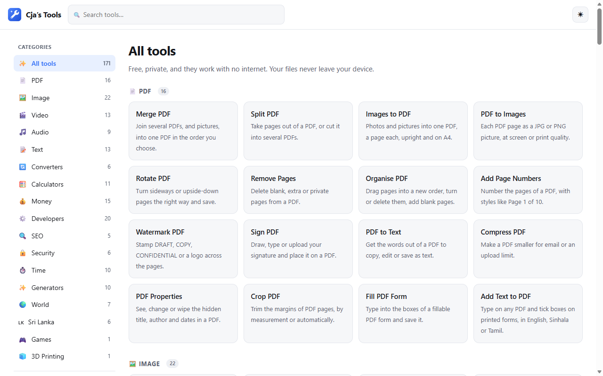
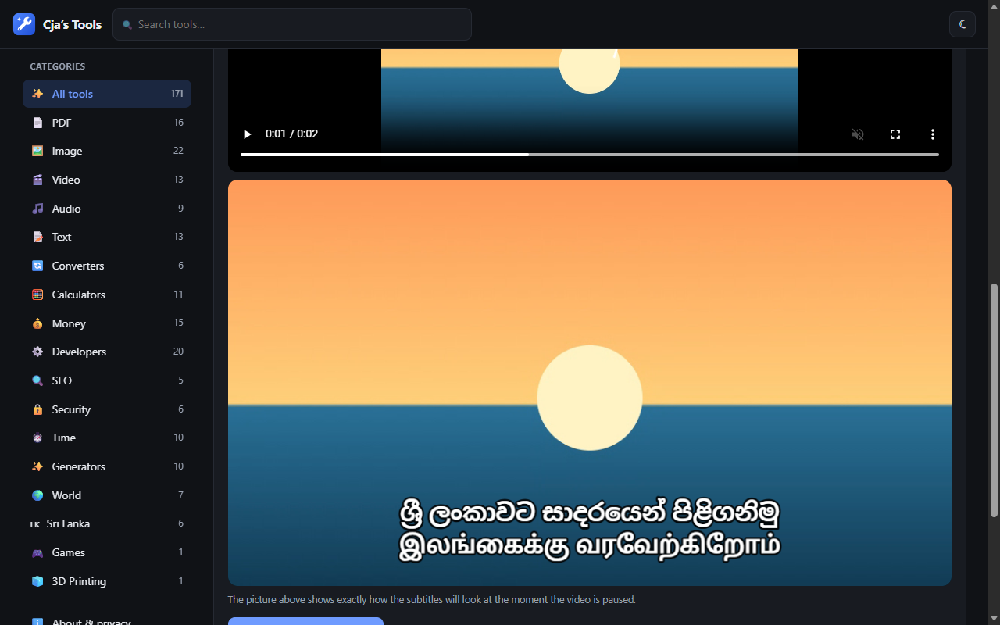
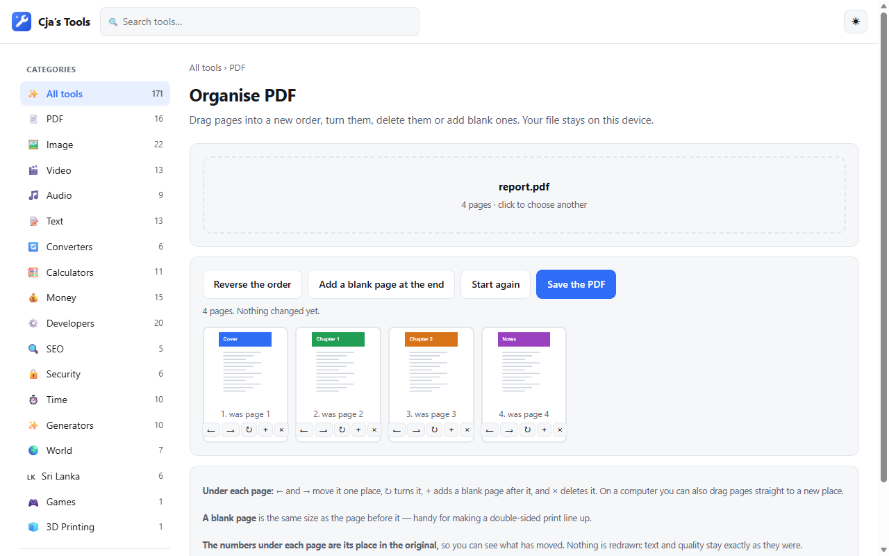
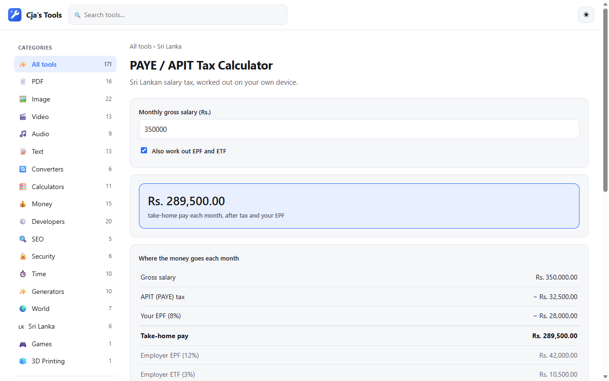
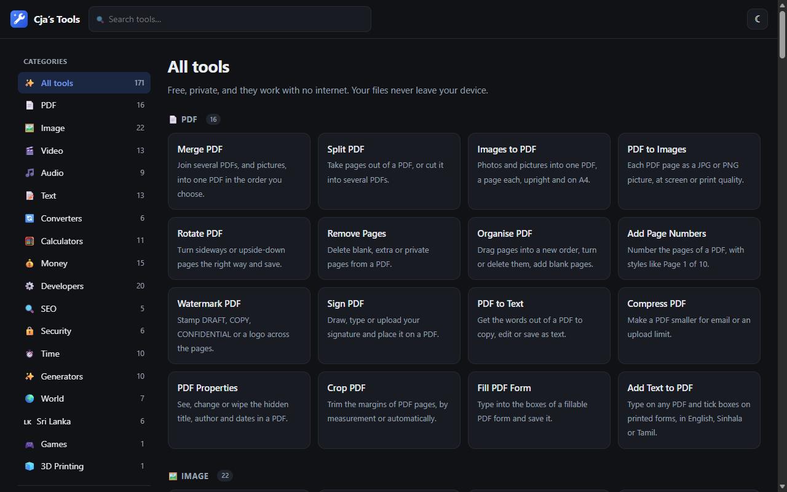

<p align="center"></p>

<h1 align="center">Cja's Tools</h1>

<p align="center"><b>171 free tools for everyday jobs — on your own computer.</b><br>
PDFs, photos, video, sound, text, money and more. No uploads, no sign-up, no ads, and it works with no internet.</p>

<p align="center">
  <a href="https://github.com/chami123jano/cjas-tools/releases/latest"><b>Download for Windows</b></a> ·
  <a href="https://chami123jano.github.io/cjas-tools/"><b>Use it in your browser</b></a>
</p>



## Get it

| | |
|---|---|
| **Windows app (recommended)** | From the [download page](https://github.com/chami123jano/cjas-tools/releases/latest), get **Cjas-Tools-…-setup.exe** and open it. It installs for you only — no administrator password — and adds Cja's Tools to the Start menu. |
| **Windows, no install** | Get **Cjas-Tools-…-portable.exe** instead and just run it, from anywhere, even a USB stick. |
| **Any computer or phone** | Open **[chami123jano.github.io/cjas-tools](https://chami123jano.github.io/cjas-tools/)** in a browser. Same tools, nothing to install. |

> **"Windows protected your PC"?** The first time you open it, Windows may show this
> because the app is new and not signed with a paid certificate. Click **More info** →
> **Run anyway**. If you would rather not, use the website — it has the same tools.

Needs Windows 10 or 11 (64-bit). To update, install the new version over the old one;
your saved items are kept. **About & privacy** in the app has a *Check for a newer version*
button. To remove it: Windows Settings → Apps → Cja's Tools → Uninstall.

## Private by design

Every tool works inside the window on your own device. Files you open are **never
uploaded** — there is no server to upload them to. No account, no tracking, no ads.
The desktop app needs no internet, except for the two tools whose job is fetching
live exchange rates.

## What's inside

| | |
|---|---|
| **PDF** (16) | Merge, split, compress, organise and rotate pages, sign, fill forms, add text, page numbers or a watermark, crop, PDF ↔ pictures, PDF to text, properties |
| **Images** (22) | Compress, convert, resize, crop, remove background, passport photos, collage, meme maker, filters, watermark, add text, blur or pixelate, round corners, borders, splitter, compare, colour picker, favicon, SVG to PNG, screenshot beautifier, ASCII art |
| **Video** (13) | Trim, compress, join, convert, rotate, speed, resize for Status / Reels, add subtitles (Sinhala and Tamil too), sound on / off / music, video to GIF, MP3 or pictures, screen recorder |
| **Audio** (9) | Cutter, voice recorder, volume, join, speed and reverse, bass and treble, remove silence, tone generator, metronome — all save as MP3 or WAV |
| **Text** (13) | Word counter, case converter, find and replace, sort, remove duplicates or extra spaces, compare, Markdown to HTML, notepad, emoji search, fancy text, blackboard, text to handwriting |
| **Money** (15) | Compound interest, loans and mortgages, savings goals, budget, net worth, debt and credit card payoff, payslip, inflation, rent or buy, simple bookkeeping and more |
| **Calculators & converters** (17) | Percentage, BMI, age, EMI, discount, bill splitter, dates and business days, GPA and grades, units, number bases, currency, time zones, CSV to JSON |
| **Sri Lanka** (6) | PAYE / APIT tax, Poya calendar, Singlish to Sinhala, postal codes, rupee exchange rates, NIC number decoder |
| **Everyday** (35) | QR codes (make and scan), barcodes, passwords, encrypted notes, photo metadata remover, focus timer, alarm, to-do list, habit tracker, reminders for birthdays, documents and vehicles, Morse, Braille, number to words, typing test, box generator and more |
| **Developers & SEO** (25) | JSON, Base64, UUID, JWT, regex, cron, diff, timestamps, TypeScript from JSON, cURL converter, token counter, text chunker, meta tags, robots.txt, sitemap, social card preview and more |

<table>
  <tr>
    <td></td>
    <td></td>
  </tr>
  <tr>
    <td align="center">Subtitles in Sinhala and Tamil (dark mode)</td>
    <td align="center">Organise the pages of a PDF</td>
  </tr>
  <tr>
    <td></td>
    <td></td>
  </tr>
  <tr>
    <td align="center">Sri Lankan salary tax</td>
    <td align="center">Light or dark, or follow Windows</td>
  </tr>
</table>

Something not working? Please say what you did and what happened on the
[problems page](https://github.com/chami123jano/cjas-tools/issues).

---

## For developers

Plain HTML, CSS and JavaScript with no framework and no build step: every tool is one
page in [`src/tools/`](src/tools/), listed in [`src/assets/tools.js`](src/assets/tools.js).
The website is `src/` as it is, published by GitHub Pages. The desktop app wraps the same
files with [Tauri](https://tauri.app).

```sh
npm install
npm test                      # logic tests for every tool (no browser needed)
npm run test:browser          # every page in Microsoft Edge
npm run test:images           # also test:pdfs, test:audio, test:video
npx tauri build               # the Windows app and installer (needs Rust)
npm run test:app              # tests the built app
npm run pages                 # after adding a tool: icons, search details, sitemap
node scripts/screenshots.js   # refreshes the pictures above
```

## Licence

[MIT](LICENSE), for the code of this project.

The tools also use free libraries written by others, kept unchanged in
`src/assets/vendor/` with their own licences: pdf-lib (MIT), PDF.js (Apache 2.0),
jsQR (Apache 2.0), qrcode-generator (MIT), and FFmpeg for video and sound
(GPL 2 or later, via ffmpeg.wasm). FFmpeg's source code and the exact build are
listed in `src/assets/vendor/ffmpeg/THIRD-PARTY.txt`. Subtitles in Sinhala and Tamil
use the Noto Sans fonts (SIL Open Font Licence, in `src/assets/vendor/fonts/`).

Made in Sri Lanka by Chamindu Janodya Ambawatta.
